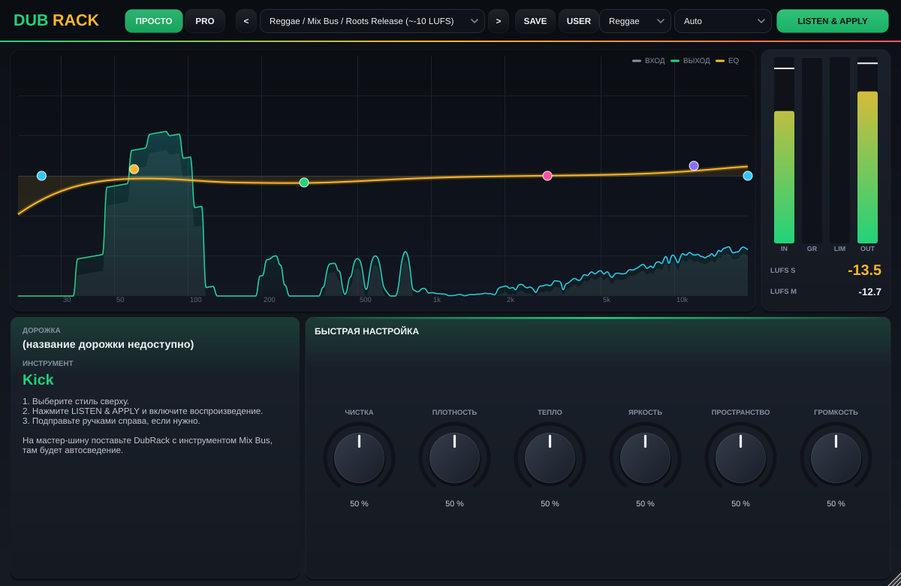
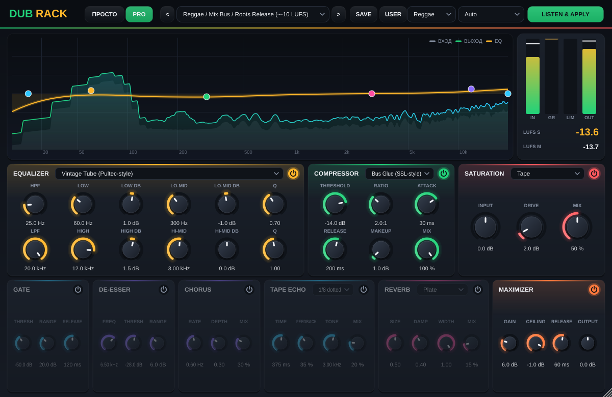

# DubRack — all-in-one канальная линейка для регги / ска / рокстеди / даба

VST3-плагин (Windows / macOS) на JUCE 8.

## Как пользоваться (режим «ПРОСТО»)
1. Поставьте DubRack на дорожку. Если дорожка названа понятно (Kick, Бочка, Bass, Скенк, Trumpet, Вокал...), инструмент определится сам.
2. Выберите стиль (Reggae / Ska / Rocksteady / Dub) и нажмите **LISTEN & APPLY**, включите воспроизведение.
   Плагин послушает ~6 секунд: подберёт цепочку, выставит уровень, срежет лишний низ по реальному спектру,
   уберёт до 3 резонансов, включит гейт от протечек на живых бочке/снейре/томах и де-эссер на вокале, трубе, хэтах.
3. Подправьте 6 ручками: Чистка, Плотность, Тепло, Яркость, Пространство, Громкость.
4. На мастер-шину поставьте DubRack (инструмент Mix Bus или дорожка Stereo Out) и нажмите **АВТОСВЕДЕНИЕ**
   на самой плотной части песни. Все DubRack в проекте слушаются одновременно: выставляется баланс громкости
   по стилю, срез низа у всего, кроме баса и бочки, место для вокала в скенке, клавишах и духовых,
   и мастер доводится до релизной громкости (Reggae ~-10 LUFS, Ska ~-9, Rocksteady ~-11).

Вкладка **PRO** показывает все модули и ручки.




## Что внутри
Цепочка: Input → EQ → Compressor → Saturation → Chorus → Tape Echo → Reverb → Maximizer → Output

| Модуль | Модели |
|---|---|
| EQ (6 полос: HPF, Low shelf, 2 колокола, High shelf, LPF) | Clean, Vintage Tube (Pultec-style), British Console |
| Гейт (против протечек живых барабанов), де-эссер, 3 авто-нотча | |
| Компрессор | Clean VCA, FET (1176-style), Opto (LA-2A-style), Bus Glue (SSL-style) |
| Сатурация (2x оверсемплинг) | Tape, Tube, Transistor |
| Tape Echo (даб-эхо с синхронизацией к темпу) | Free / 1/4 / 1/4. / 1/8 / 1/8. / 1/8T / 1/16 |
| Ревер | Room, Plate, Hall, Spring |
| Максимайзер | look-ahead brickwall лимитер |

- Анализатор спектра (вход/выход) с кривой EQ; точки EQ можно таскать мышкой (колесо = Q, двойной клик = сброс).
- Метры: вход, gain reduction компрессора и лимитера, выход, LUFS-M и LUFS-S.
- ~65 заводских пресетов: Reggae / Ska / Rocksteady / Dub / Mastering × инструмент
  (кик, снейр, хэт, томы, оверхеды, рум, барабанная шина, перкуссия, бас, скенк, соло-гитара,
  орган, пиано, труба, альт/тенор/баритон-сакс, тромбон, бас-тромбон, духовая секция, вокал, бэки, мастер-шина).
  Также видны в меню пресетов Cubase. Свои пресеты: SAVE / USER (Документы\DubRack\Presets).
- Умный режим (LISTEN & APPLY): выбираете стиль и инструмент (или Auto), жмёте, включаете воспроизведение.
  Плагин слушает ~6 секунд, выставляет входной уровень, подбирает цепочку из пресетов и вырезает найденный резонанс.

## Сборка
```
cmake -S . -B build
cmake --build build --config Release --target DubRack_VST3
```
JUCE скачивается автоматически. Готовый файл: `build/DubRack_artefacts/Release/VST3/DubRack.vst3`.
На GitHub сборку делает `.github/workflows/build.yml` (Windows и macOS), файл появляется в Artifacts.

Установка в Windows: скопировать папку `DubRack.vst3` в `C:\Program Files\Common Files\VST3\`, в Cubase: Studio → VST Plug-in Manager → Update.

Тест-инструмент: `-DDUBRACK_TOOLS=ON` собирает `DubRackSnapshot` (прогон всех пресетов + скриншот).

## Дальше по плану
2. Больше моделей (Pultec-режим с отдельными boost/atten, 1176 all-buttons, LA-2A peak reduction, de-esser, transient shaper, гейт для живых барабанов, multiband), A/B, undo.
3. Умный режим v2: лучшее распознавание инструментов, учёт протечек микрофонов.
4. Связь экземпляров между дорожками + авто-баланс микса и доводка мастера до целевого LUFS.
