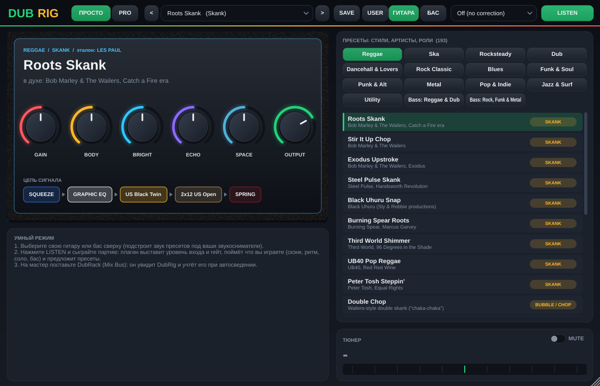
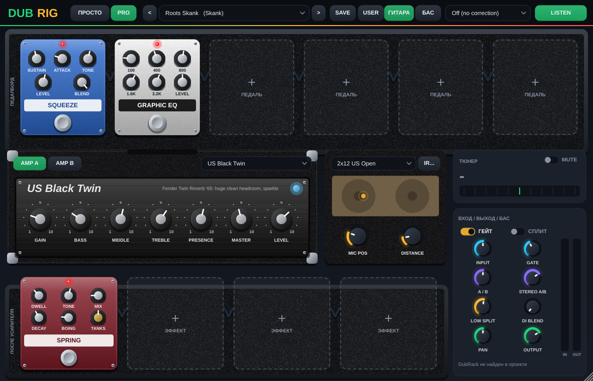

# DubRack — all-in-one канальная линейка для регги / ска / рокстеди / даба

VST3-плагин (Windows / macOS) на JUCE 8.

## Как пользоваться (режим «ПРОСТО»)
1. Поставьте DubRack на дорожку. Если дорожка названа понятно (Kick, Бочка, Bass, Скенк, Trumpet, Вокал...), инструмент определится сам.
2. Выберите стиль (Reggae / Ska / Rocksteady / Dub) и нажмите **LISTEN & APPLY**, включите воспроизведение.
   Плагин послушает ~6 секунд: подберёт цепочку, выставит уровень, срежет лишний низ по реальному спектру,
   уберёт до 3 резонансов, включит гейт от протечек на живых бочке/снейре/томах и де-эссер на вокале, трубе, хэтах.
3. Подправьте 6 ручками: Чистка, Плотность, Тепло, Яркость, Пространство, Громкость.
4. На мастер-шину поставьте DubRack (инструмент Mix Bus или дорожка Stereo Out) и нажмите **АВТОСВЕДЕНИЕ**
   на самой плотной части песни. Все DubRack в проекте слушаются одновременно: выставляется баланс громкости
   по стилю, срез низа у всего, кроме баса и бочки, место для вокала в скенке, клавишах и духовых,
   и мастер доводится до релизной громкости (Reggae ~-10 LUFS, Ska ~-9, Rocksteady ~-11).

Вкладка **PRO** показывает все модули и ручки.


## Что внутри
Цепочка: Input → EQ → Compressor → Saturation → Chorus → Tape Echo → Reverb → Maximizer → Output

| Модуль | Модели |
|---|---|
| EQ (6 полос: HPF, Low shelf, 2 колокола, High shelf, LPF) | Clean, Vintage Tube (Pultec-style), British Console |
| Гейт (против протечек живых барабанов), де-эссер, 3 авто-нотча | |
| Компрессор | Clean VCA, FET (1176-style), Opto (LA-2A-style), Bus Glue (SSL-style) |
| Сатурация (2x оверсемплинг) | Tape, Tube, Transistor |
| Tape Echo (даб-эхо с синхронизацией к темпу) | Free / 1/4 / 1/4. / 1/8 / 1/8. / 1/8T / 1/16 |
| Ревер | Room, Plate, Hall, Spring |
| Максимайзер | look-ahead brickwall лимитер |

- Анализатор спектра (вход/выход) с кривой EQ; точки EQ можно таскать мышкой (колесо = Q, двойной клик = сброс).
- Метры: вход, gain reduction компрессора и лимитера, выход, LUFS-M и LUFS-S.
- ~65 заводских пресетов: Reggae / Ska / Rocksteady / Dub / Mastering × инструмент
  (кик, снейр, хэт, томы, оверхеды, рум, барабанная шина, перкуссия, бас, скенк, соло-гитара,
  орган, пиано, труба, альт/тенор/баритон-сакс, тромбон, бас-тромбон, духовая секция, вокал, бэки, мастер-шина).
  Также видны в меню пресетов Cubase. Свои пресеты: SAVE / USER (Документы\DubRack\Presets).
- Умный режим (LISTEN & APPLY): выбираете стиль и инструмент (или Auto), жмёте, включаете воспроизведение.
  Плагин слушает ~6 секунд, выставляет входной уровень, подбирает цепочку из пресетов и вырезает найденный резонанс.

## Сборка
```
cmake -S . -B build
cmake --build build --config Release --target DubRack_VST3
```
JUCE скачивается автоматически. Готовый файл: `build/DubRack_artefacts/Release/VST3/DubRack.vst3`.
На GitHub сборку делает `.github/workflows/build.yml` (Windows и macOS), файл появляется в Artifacts.

Установка в Windows: скопировать папку `DubRack.vst3` в `C:\Program Files\Common Files\VST3\`, в Cubase: Studio → VST Plug-in Manager → Update.

Тест-инструмент: `-DDUBRACK_TOOLS=ON` собирает `DubRackSnapshot` (прогон всех пресетов + скриншот).

На мастер-шине DubRack показывает **карту микса**: все дорожки с DubRack и DubRig по панораме и громкости,
и подсказки, кто с кем спорит по частотам.

---

# DubRig — гитарный и басовый процессор, связанный с DubRack

Отдельный VST3 (и Standalone) в этом же репозитории. Усилители, кабинеты, педали, NAM-профили, свои IR,
191 пресет по стилям, артистам и ролям, режим баса. Знает про DubRack: мастер видит его панораму,
громкость и спектр и сводит гитары вместе с остальным миксом.




## Как подключить
Гитара или бас в Hi-Z вход звуковой карты (Scarlett 2i2: кнопка INST), моно-дорожка в Cubase, DubRig в первый слот,
мониторинг включён. Для реампа: записанный «сухой» DI на дорожке, DubRig как обычный инсерт.
Если на дорожке после DubRig стоит DubRack, он сам поймёт инструмент из DubRig.

## Режим «ПРОСТО»
1. Сверху выберите **ГИТАРА / БАС** и свой инструмент (Strat, Tele, Les Paul, SG, 335, P-Bass, J-Bass, Stingray...):
   пресеты подстроятся под ваши звукосниматели.
2. Выберите пресет по стилю (категории слева направо) или нажмите **LISTEN** и сыграйте 8 секунд:
   DubRig выставит входной уровень и гейт, поймёт, что вы играете (скэнк, бабл, ритм, рифф, соло, бас пальцами / медиатором / слэп / саб)
   и предложит подходящие пресеты.
3. Подкрутите 6 ручек: GAIN, BODY, BRIGHT, ECHO, SPACE, OUTPUT. Внизу видна вся цепь сигнала.

## Режим PRO
- **Педалборд** (6 мест до усилителя) и **FX-луп** (4 места после кабинета). Любая педаль в любое место, порядок свободный:
  перетащите педаль за корпус; клик по табличке с названием меняет педаль; правый клик: переместить, убрать.
- **Два усилителя** (A и B, параллельно, с балансом и разносом по стерео), у каждого свой кабинет.
- Справа тюнер (с мьютом), вход, гейт, сплит низа для баса (LOW SPLIT + DI BLEND), панорама, выход, метры.

### Усилители (20)
Jazz Chorus 120, US Black Twin, US Black Deluxe, Tweed Bassman, Tweed Deluxe 5E3, Brit AC Top Boost, Brit JTM 45, Brit Plexi 100,
Brit 800 Lead, Hi-Power 100 (HiWatt), US Rectified, Cali Mark Lead, German Ultra, Kingston Studio DI;
басовые: SVT Classic, Flip-Top B15, Solid 800, Valve 300, Studio DI; плюс **NAM Capture** (любой профиль Neural Amp Modeler).
Модели строятся как реальная схема: каскады ламп с ассиметрией, пассивный тембр-блок по номиналам (Fender / Marshall / Vox / Mesa),
оконечник с просадкой питания и выходным трансформатором, 4x оверсемплинг.

### Кабинеты (18 + свой IR)
1x12 / 2x12 US Open, 2x12 Jazz Chorus, 4x10 Tweed, 2x12 Brit Blue, 4x12 Greenback, 4x12 V30, 4x12 US Rect, 1x12 Tweed Small,
4x12 Hi-Power Fane, Console, 8x10 Bass Fridge, 1x15 Flip-Top, 4x10 Bass + Horn, 2x15 Sound System, Bass DI, **User IR** (.wav), No Cab.
Положение и расстояние микрофона. Встроенные кабинеты смоделированы фильтрами, а для фирменного звука загрузите IR (кнопка **IR...**).

### Педали (24)
Компрессор (CS-3 / Dyna Comp / Ross), Treble Boost, овердрайв (TS808, SD-1, Klon, BD-2, OCD), дисторшн (DS-1, RAT, HM-2, Metal Zone),
фузз (Fuzz Face, Big Muff, Tone Bender, Octavia), вау (Cry Baby / V847, авто), энвелоп-фильтр (Mu-Tron III, Q-Tron, AW-3),
октавер OC-2, фейзер (Phase 90, PH-3, Small Stone), флэнжер (BF-2, Electric Mistress), хорус (CE-2, Small Clone, Dimension),
Uni-Vibe, тремоло (TR-2, оптическое, гармоническое), Leslie, Space Echo RE-201, дилей (DD-3, DM-2, Memory Man, пинг-понг),
пружинный ревер, ревер (Room / Plate / Hall / Ambient), графический EQ GE-7, шумодав NS-2, Slow Gear, автопанорама,
Bass Driver (SansAmp / Darkglass), саб-синт.

### Пресеты (191)
| Категория | Шт. | Например |
|---|---|---|
| Reggae | 20 | Marley skank, Steel Pulse, Black Uhuru, Third World, UB40, Peter Tosh |
| Ska | 12 | Skatalites, Specials, Madness, Toots |
| Rocksteady | 8 | Alton Ellis, Treasure Isle |
| Dub | 14 | King Tubby, Lee Perry, Scientist (эхо, пружины, сирены) |
| Dancehall & Lovers | 6 | |
| Rock Classic | 25 | Keith Richards (open G), Beatles, Queen (Brian May), Led Zeppelin, AC/DC, Hendrix, Pink Floyd |
| Blues | 12 | SRV, BB King, Clapton, Albert King |
| Funk & Soul | 12 | Nile Rodgers, Hendrix chords, Curtis Mayfield |
| Punk & Alt | 12 | Clash, Ramones, Nirvana, RHCP |
| Metal | 14 | Metallica, Rammstein, System of a Down, Black Sabbath, Pantera |
| Pop & Indie | 10 | |
| Jazz & Surf | 6 | |
| Utility | 6 | чистый DI, реамп, тюнинг |
| Bass: Reggae & Dub | 14 | Family Man Barrett, Robbie Shakespeare, саунд-систем саб |
| Bass: Rock, Funk & Metal | 20 | McCartney, John Deacon, Flea, Jaco, Geezer Butler, Shavo Odadjian |

Каждый пресет помечен ролью (Skank, Bubble / Chop, Rhythm, Riff, Lead, Clean, Dub FX, Bass Roots / Pick / Slap / Sub)
и выровнен по громкости (около -18 LUFS). Названия «в духе» артистов: это ориентир звука, не копия фирменных пресетов.
Свои пресеты: **SAVE / USER** (Документы\DubRig Presets, файлы `.dubrig`).

## NAM-профили и IR
- **NAM**: в усилителе выберите «NAM Capture» и кнопку **NAM...**. Профили (`.nam`) тысячами бесплатно на
  [tone3000.com](https://www.tone3000.com) (раньше ToneHunt). Уровень подгоняется сам, ручка NAM IN = сколько «газа» в профиль.
  Если профиль снят с кабинетом (full rig), ставьте кабинет «No Cab».
- **IR**: кабинет «User IR», кнопка **IR...**, любой `.wav`. Бесплатные наборы: на сайтах производителей (например, бесплатные паки
  OwnHammer, God's Cab, Celestion), их нельзя класть в этот репозиторий по лицензии, поэтому они загружаются вручную.

## Связь с DubRack
- Каждый DubRig сообщает мастеру: дорожку, роль (скэнк / соло / ритм / бас), стиль, свою панораму, ширину, громкость и спектр по октавам.
- **АВТОСВЕДЕНИЕ** на DubRack (Mix Bus) учитывает дорожки с DubRig: выставляет громкость гитары по стилю, срезает низ
  и, если несколько гитар/клавиш стоят в центре, разводит их по панораме (L35 / R35). Всё это видно в DubRig (ручки LINK).
- Карта микса на мастере показывает, где каждый инструмент и кто кого маскирует.

## Сборка
```
cmake -S . -B build
cmake --build build --config Release --target DubRig_VST3
```
NeuralAmpModelerCore (MIT) скачивается автоматически. Готовый файл: `build/DubRig_artefacts/Release/VST3/DubRig.vst3`.
С `-DDUBRACK_TOOLS=ON` собирается `DubRigSnapshot`: прогон всех пресетов (NaN, пики, тишина, CPU), `--shot` (скриншоты),
`--link` (проверка связи с DubRack), `--calibrate` (выравнивание громкости пресетов), `--nam файл.nam`.
